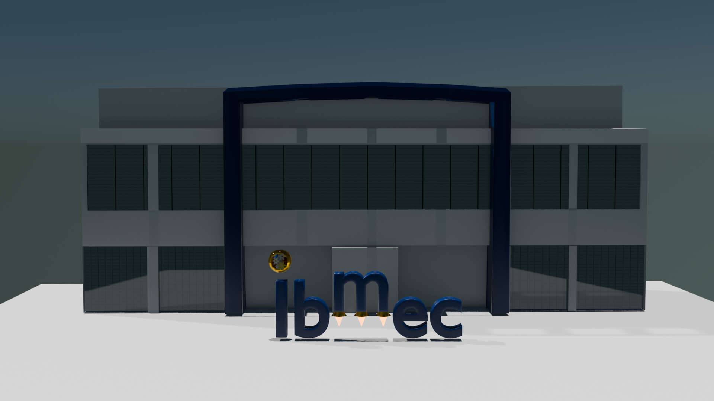
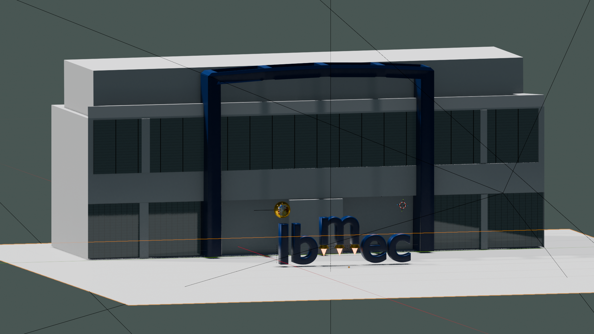

# AC04 — Iluminação e Modelos de Reflexão: Lambert, Phong e Blinn-Phong

**Instituição:** Ibmec Barra da Tijuca / Rio  
**Disciplina:** Computação Gráfica (IBM0168/8001)  
**Aluno:** Alex Oliveira  
**Ambiente:** Blender 4.5 LTS  

---

## 1. Evidências Visuais da Prática

### 1.1. Cena Final Completa (Continuidade AP1)

### 1.2. Comparativo dos Três Objetos e Materiais

---

## 2. Configuração da Iluminação e Ambiente

* **Céu / Ambiente (World):** Shader procedural *Hosek-Wilkie Sky Texture* com turbidez `2.2`, albedo de solo `0.3` e vetor solar `(0.55, -0.65, 0.52)` sob intensidade `0.65`, reproduzindo a atmosfera litorânea diurna da Barra da Tijuca.
* **Luz Principal (Key Light - Sun):** Fonte `Luz_Principal_Sun` com energia `2.6`, cor solar quente `(1.0, 0.98, 0.94)`, ângulo angular de `1.5°` e rotação calibrada a $45^\circ$ para produzir áreas iluminadas definidas e sombras volumétricas nítidas.
* **Luz de Preenchimento (Fill Light - Area):** Fonte `Luz_Preenchimento_Area` com potência `25.0 W`, cor neutra-quente `(0.95, 0.93, 0.88)` simulando a reflexão difusa do solo arenoso e garantindo a visibilidade das faces em penumbra.
* **Gerenciamento de Cor:** Transformação *AgX* com contraste *Medium High Contrast* e compensação de exposição em `-0.2`.

---

## 3. Identificação dos Objetos e Especificação dos Materiais

| Objeto Autoral | Material Atribuído | Cor Base (Hex / sRGB) | Rugosidade (Roughness) | Especular / Metallic | Modelo de Iluminação |
| :--- | :--- | :--- | :--- | :--- | :--- |
| **`autoral_03_predio_ibmec`** | `MAT_Lambert` | Cinza Claro `(0.80, 0.80, 0.82)` | `1.00` | `IOR Level = 0.0` / `Metallic = 0.0` | **Lambert (Reflexão Difusa Pura)** |
| **`autoral_02_propulsores_do_negocio`** | `MAT_Phong` | Amarelo Ibmec Oficial (`#FFC72C`) | `0.20` | `Metallic = 1.0` / `IOR Level = 0.5` | **Phong (Difusa + Especular Polido)** |
| **`autoral_01_nucleo_energia`** | `MAT_BlinnPhong` | Amarelo Ibmec Oficial (`#FFC72C`) | `0.05` | `Metallic = 1.0` / `IOR Level = 1.0` | **Blinn-Phong (Especular via Vetor Médio)** |

*Elementos complementares de cena:*
* **Fachada envidraçada (`MAT_Vidro_Arquitetonico`):** Pele de vidro modular quadriculada via nó `Brick Texture` com transmissão translúcida (`Transmission = 0.85`), reflexo espelhado nítido (`Roughness = 0.02`) e esquadrias finas escuras.
* **Letras `Ibmec`:** Azul Institucional Oficial (`#002F6C`) com acabamento corporativo acetinado (`Roughness = 0.35`).
* **Propulsão e Chamas (`MAT_Fogo`):** Material emissivo alaranjado incandescente com força `8.0`.
* **Maquinário Interno do Núcleo:** Intercalação mecânica entre prata industrial (`Roughness = 0.15`), cobre escuro oxidado (`Roughness = 0.25`) e cabeamento isolante fosco (`NurbsPath`).

---

## 4. Análise Comparativa dos Três Modelos de Iluminação

1. **Modelo Lambert (`MAT_Lambert`):**
   * *Comportamento visual:* A fachada do edifício comporta-se de forma perfeitamente fosca. A reflexão luminosa independe do ponto de vista da câmera, sendo proporcional unicamente ao cosseno do ângulo de incidência do sol ($\mathbf{N} \cdot \mathbf{L}$). Não há formação de brilho concentrado (*highlight*).
2. **Modelo Phong (`MAT_Phong`):**
   * *Comportamento visual:* Os propulsores metálicos apresentam destaque especular polido de raio médio. A reflexão é governada pelo produto escalar entre o vetor do raio refletido e a direção do observador ($\mathbf{R} \cdot \mathbf{V}$), gerando uma transição suave entre a área iluminada e a penumbra.
3. **Modelo Blinn-Phong (`MAT_BlinnPhong`):**
   * *Comportamento visual:* A esfera mecânica apresenta pontos de luz (*highlights*) mais nítidos, intensos e pontuais. Por basear-se no vetor médio entre a luz e a câmera ($\mathbf{H} = \frac{\mathbf{L} + \mathbf{V}}{\|\mathbf{L} + \mathbf{V}\|}$) projetado contra a normal ($\mathbf{N} \cdot \mathbf{H}$), o cálculo preserva a coerência do brilho mesmo sob ângulos de observação rasantes, realçando a curvatura da geometria.

---

## 5. Nota Técnica: Principled BSDF vs. Modelos Clássicos

O nó `Principled BSDF` do Blender 4.5 LTS é um shader fisicamente baseado (PBR) que opera sob a distribuição de microfacetas de Smith/GGX com conservação estrita de energia. 

Dessa forma, as configurações adotadas representam **aproximações visuais empíricas**:
* O modelo de Lambert foi emulado anulando o parâmetro especular e elevando a rugosidade ao limite.
* Os modelos de Phong e Blinn-Phong foram aproximados pela redução da rugosidade e calibração das componentes de intensidade especular (`Specular IOR Level`) e metalicidade, reproduzindo o comportamento visual dos expoentes de reflexão especular das formulações analíticas clássicas.