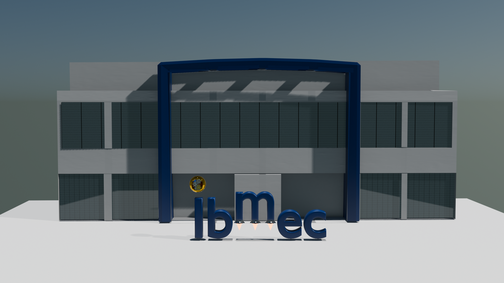
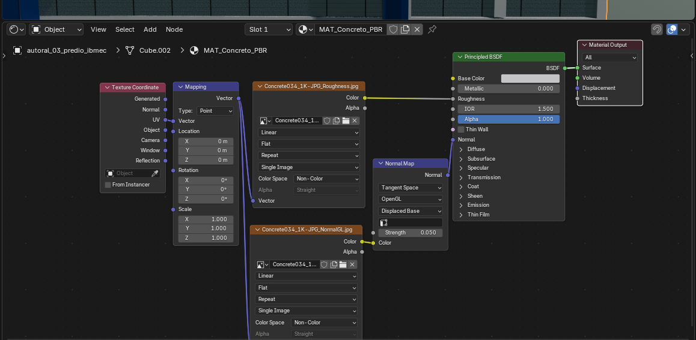
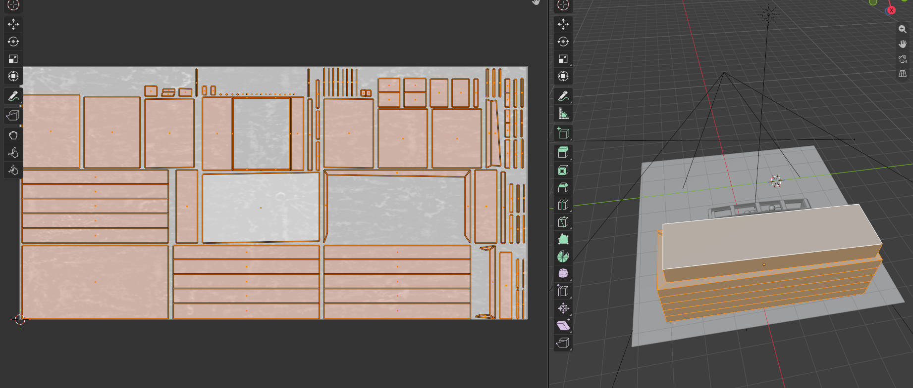

# AC05 — Materiais PBR, Mapeamento UV e Texturas no Blender 4.5 LTS

**Instituição:** Ibmec Barra da Tijuca / Rio  
**Disciplina:** Computação Gráfica (IBM0168/8001)  
**Aluno:** Alex Oliveira  
**Ambiente:** Blender 4.5 LTS  

---

## 1. Evidências Visuais da Prática

### 1.1. Render Final da Cena

### 1.2. Árvore de Nós no Shader Editor (Base Color, Roughness e Normal Map)

### 1.3. Desdobramento de Malha no UV Editor

---

## 2. Descrição dos Três Objetos Autorais e Materiais PBR

| Objeto Autoral | Material PBR Atribuído | Propriedades Principais | Mapas de Textura / Setup |
| :--- | :--- | :--- | :--- |
| **`autoral_03_predio_ibmec`** | `MAT_Concreto_PBR` | `Metallic = 0.0` (Dielétrico), `Roughness` mapeado, `IOR = 1.50` | 3 Canais: Base Color, Roughness e Normal (OpenGL) |
| **`autoral_02_propulsores_do_negocio`** | `MAT_Metal_Industrial_PBR` | `Metallic = 1.0` (Condutor puro), rugosidade de aço escovado | 2 Canais: Base Color Metálico e Roughness |
| **`autoral_01_nucleo_energia`** | `MAT_BlinnPhong` / Ouro Espelhado | `Metallic = 1.0`, `Roughness = 0.05`, Amarelo `#FFC72C` | Procedural PBR de altíssima reflexão (preservado da AC04) |

*Elementos adicionais e identidade de marca:*
* **Tipografia `Ibmec`:** Mantida no Azul Institucional oficial (`#002F6C`), acabamento acetinado limpo (`Roughness = 0.35`) e sem adição de texturas externas para proteger a integridade da marca.
* **Maquinário Interno do Núcleo:** Conjunto mecânico visível composto por engrenagens em prata industrial (`Roughness = 0.15`), buchas em cobre escuro oxidado (`Roughness = 0.25`) e cabeamento elétrico emborrachado (`NurbsPath`).
* **Fachada Envidraçada:** Painéis quadriculados procedurais (`MAT_Vidro_Arquitetonico`) com reflexão nítida e esquadrias escuras integradas.
* **Chamas de Propulsão:** Material emissivo incandescente `MAT_Fogo` com força `8.0`.

---

## 3. Gestão Técnica de Canais e Espaços de Cor (*Color Space*)

Conforme preconizado nos fluxos de renderização fisicamente baseada (PBR):
* **Base Color (Albedo):** Configurado no espaço de cor **`sRGB`**. Como este canal representa a refletância cromática difusa percebida pelo olho humano, a decodificação da curva de gama é necessária para a correta fidelidade perceptual de cor.
* **Roughness:** Configurado rigorosamente como **`Non-Color`**. Este mapa fornece dados escalares puros que quantificam a distribuição estatística das microfacetas ($0.0$ polido a $1.0$ fosco). Interpretar esses dados em sRGB alteraria artificialmente a física dos reflexos.
* **Normal Map:** Carregado em **`Non-Color`** e direcionado obrigatoriamente à entrada *Color* do nó intermediário **Normal Map (Tangent Space)**, cuja saída *Normal* alimenta o *Principled BSDF*. O nó converte as coordenadas de cores vetoriais (RGB) em perturbações angulares físicas sobre as normais da geometria. A intensidade (*Strength*) foi calibrada em `0.25` para gerar relevo tátil sem produzir sombras rasantes artificiais.

---

## 4. Metodologia de Mapeamento UV e Escala

* **Desdobramento de Malhas (Unwrapping):** Aplicado o método **Smart UV Project** com margem de segurança entre ilhas de `0.01` (`Island Margin`) tanto na fachada arquitetônica do edifício quanto nas peças cônicas dos propulsores. Esse espaçamento impede o sangramento (*bleeding*) de pixels entre faces adjacentes nas junções de quina.
* **Controle Paramétrico de Tiling:** Inserido o conjunto de nós **Texture Coordinate (saída UV)** e **Mapping** conectado às entradas de vetor das imagens. Esse controle permitiu calibrar a repetição das ranhuras do concreto e o grão escovado do aço, mantendo a escala arquitetônica crível em relação à proporção global da cena.

---

## 5. Origem e Licença dos Recursos Externos

* **Fontes das Texturas:** Repositórios públicos [ambientCG](https://ambientcg.com) e [Poly Haven](https://polyhaven.com).
* **Licenciamento:** *Creative Commons CC0 1.0 Universal Public Domain Dedication* (livre para utilização acadêmica, modificação e distribuição).
* **Empacotamento de Ativos:** Todos os arquivos de imagem foram embutidos diretamente no contêiner `.blend` através do comando nativo **Pack Resources** (`File > External Data > Pack Resources`), garantindo portabilidade integral sem dependência de caminhos absolutos locais quebrados.

---

## 6. Influência da Iluminação na Resposta dos Materiais

A iluminação mista adotada (céu procedural diurno *Hosek-Wilkie* somado ao sol direcional rasante e luz de preenchimento difusa) evidencia com clareza o comportamento óptico distinto de cada superfície:
1. O concreto arquitetônico reage com micro-sombras volumétricas graças ao mapa de normais.
2. O aço escovado dos propulsores exibe brilho alongado e reflexos coerentes com seu índice de metalicidade unitário.
3. A casca dourada e o maquinário interno mantêm pontos de luz nítidos (*specular highlights*), garantindo contraste volumétrico entre superfícies foscas, condutoras e translúcidas.